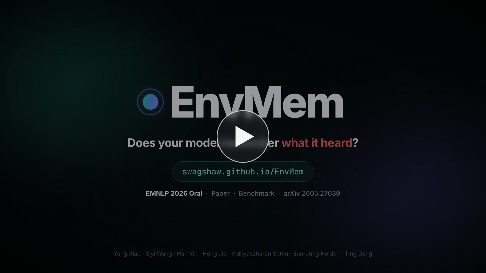

<p align="center">
  
  <a href="https://swagshaw.github.io/EnvMem/"></a>
  <a href="https://arxiv.org/abs/2605.27039"></a>
</p>

<h1 align="center">Why Can't They Remember?<br>Uncovering Representation and Retrieval Bottlenecks in Multi-Turn Acoustic Memory</h1>

<p align="center">
  Yang Xiao<sup>1</sup>&nbsp; Siyi Wang<sup>1</sup>&nbsp; Han Yin<sup>2</sup>&nbsp; Hong Jia<sup>3</sup>&nbsp; Vidhyasaharan Sethu<sup>4</sup>&nbsp; Eun-Jung Holden<sup>1</sup>&nbsp; Ting Dang<sup>1</sup>
  <br>
  <sup>1</sup>The University of Melbourne&nbsp;&nbsp; <sup>2</sup>KAIST&nbsp;&nbsp; <sup>3</sup>The University of Auckland&nbsp;&nbsp; <sup>4</sup>UNSW Sydney
</p>

<p align="center">
  <a href="https://swagshaw.github.io/EnvMem/static/video/envmem.mp4"></a>
</p>

> **TL;DR.** Audio language models remember *what was said* but forget *what was heard*.
> EnvMem places one environmental sound in the first turn of a spoken dialogue and later asks about either the sound or a fact from that same turn.
> Acoustic memory decays faster than semantic memory (relative gap +12% at 16 turns for Qwen2.5-Omni), yet the sound stays linearly decodable from deep hidden states even on failed trials.
> The failure is **representational trajectory drift**, not erasure or misallocated attention: patching in a clean representation lifts failed-trial accuracy from 0.13 to 0.75, while attention edits do nothing beyond a random control.

This repository hosts the project page. Open <https://swagshaw.github.io/EnvMem/>.

## Citation

```bibtex
@inproceedings{xiao2026envmem,
  title     = {Why Can't They Remember? Uncovering Representation and Retrieval
               Bottlenecks in Multi-Turn Acoustic Memory},
  author    = {Xiao, Yang and Wang, Siyi and Yin, Han and Jia, Hong and
               Sethu, Vidhyasaharan and Holden, Eun-Jung and Dang, Ting},
  booktitle = {Proceedings of the 2026 Conference on Empirical Methods
               in Natural Language Processing (EMNLP)},
  year      = {2026}
}
```
